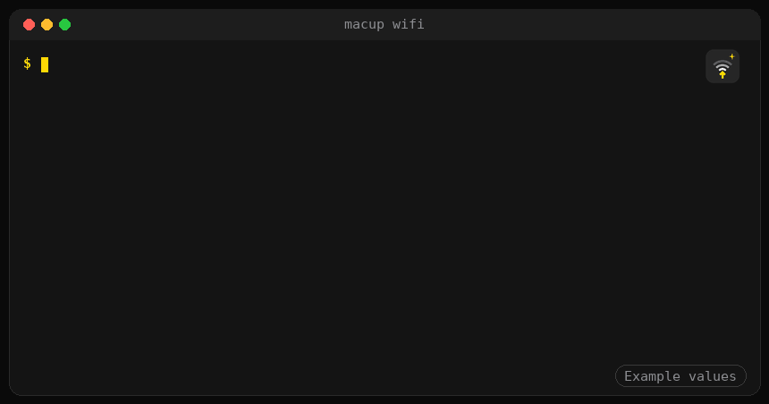

<p align="center">
  
</p>

# ✦ MacUp

**Your Mac’s health, right in Terminal. Free, forever.**

MacUp finds the hidden caches behind “System Data”, checks your SSD, battery,
memory, processor, graphics and built-in security, shows your **battery
health %** (like on iPhone) and saves a clear PDF report. **Wi-Fi Check** tells
you whether your Wi-Fi is fine — and if it isn’t, what slows it down and how to
fix it.

| | |
|---|---|
| **Free forever** | No price, no trial, no “Pro” version, no subscription, no ads, no account. |
| **Safe** | Nothing is deleted for good — everything MacUp cleans goes to the Trash. |
| **Private** | No admin password, no background process, no tracking. |
| **Every Mac** | Intel and Apple silicon, macOS 13 or newer, in 7 languages. |

🌐 English · Română · Deutsch · Italiano · Français · 한국어 · 中文

---

## Works on

| | |
|---|---|
| **Macs** | MacBook Air · MacBook Pro · iMac · Mac mini · Mac Studio · Mac Pro |
| **Chips** | Intel · Apple M1 · M2 · M3 · M4 · M5 — and every new chip, with free updates |
| **macOS** | 13 Ventura or newer, including the latest version |
| **Updates** | Free updates with one command: `macup update` |

Wi-Fi Check needs a Mac with Wi-Fi. Battery health appears on Macs with a
battery; desktop Macs (iMac, Mac mini, Mac Studio, Mac Pro) show the SSD instead.

---

## Install — 3 steps, about 1 minute

<p align="center">
  
</p>

1. **Open Terminal.** Press **⌘ Space**, type **Terminal**, press **Return**.
2. **Paste this line and press Return.** You only do this once.

   ```bash
   curl -fsSL https://raw.githubusercontent.com/CDAVIO/MacUp-Cleaner-CDAV.IO/main/install.sh | bash
   ```

3. **Type `macup` and press Return.** Choose a number from the menu.

The installer copies MacUp into `~/.macup` and adds the `macup` command. It
needs no admin password, runs nothing in the background and sends nothing
anywhere. You can read [`install.sh`](install.sh) first — it is short.

### New to Terminal?

Terminal is an app that comes with every Mac (**Applications → Utilities →
Terminal**). Instead of clicking buttons, you type a short command and press
**Return**. With MacUp, that is all you need to know:

| You want to… | Do this |
|---|---|
| Open MacUp | Type `macup` and press **Return** |
| Choose an option | Type its number (for example `7`) and press **Return** |
| Answer a question | Press **Return** for the suggested answer, or type `y` (yes) / `n` (no) |
| Go back to the menu | Press **Return** when a screen is finished |
| Quit MacUp | Type `q` at the menu and press **Return** |
| Copy or paste | **⌘ C** and **⌘ V**, like everywhere else |
| Close Terminal | **⌘ Q** — MacUp stops with it; nothing keeps running |

Every option also has its own short command, so you can skip the menu — for
example `macup wifi` or `macup check` (full list below).

---

## What MacUp does

<p align="center">
  
</p>

```
  ✦ MacUp  Mac health from the Terminal · free & open source
  ──────────────────────────────────────────────────────────────
   1  Smart Clean      Find hidden caches and move them to the Trash
   2  This Mac         Storage, SSD, battery, memory, processor, graphics
   3  Protection       Is macOS’s built-in security switched on?
   4  Performance      Load, busiest apps, startup items
   5  Complete check   Everything + battery health % + PDF report in Downloads
   6  Recent Items     Empty the Apple menu’s Recent Items list
   7  Wi-Fi Check      Is my Wi-Fi OK? Speed, ping, channel — and a fix if needed
```

| # | Command | What you get |
|---|---------|--------------|
| 1 | `macup clean` | Scans app caches, browser caches, logs, crash reports and developer caches (Xcode, npm, pip, Homebrew…). Shows sizes first. Press **Enter** to move the selected ones to the Trash, **p** to preview, numbers to select/unselect. |
| 2 | `macup mac` | Storage used/free, hidden caches, **SSD** model + S.M.A.R.T. status (+ life left % if `smartmontools` is installed), **battery** health %, cycle count, condition and charge, **RAM** free + swap, **processor** cores, load and heat, **graphics** and displays. |
| 3 | `macup protect` | Gatekeeper, System Integrity Protection, FileVault, Firewall, XProtect, security responses and automatic updates — on or off, and where to switch them on. |
| 4 | `macup perf` | Load, busiest apps (processor and memory), startup items and broken startup items. |
| 5 | `macup check` | Runs everything (read-only), shows your **battery health %**, marks every part **✓ Good** or **! Needs attention**, and saves `MacUp-Health-Report-….pdf` in **Downloads**. |
| 6 | `macup recent` | Empties Apple menu → Recent Items (applications, documents, servers) — the same as **Clear Menu**. Asks first; files and apps are never touched. |
| 7 | `macup wifi` | **Wi-Fi Check**: real speed vs. your plan, ping and jitter to your router and to the internet, band, channel, signal, how many neighbours share your channel and which one is empty, the Mac settings that slow Wi-Fi down, and the devices on your network. If something is wrong, it walks you through the fix — [details below](#wi-fi-check--is-my-wi-fi-ok). |

Other commands: `macup wifi undo`, `macup update`, `macup uninstall`,
`macup --lang ro|de|it|fr|ko|zh`, `macup --help`. The language follows your Mac
automatically.

### Example: complete check

```
  5  Complete check
  ──────────────────────────────────────────────────────────────
  Battery health  ██████████████████████░░  93%  Cycle count: 228

  !  Storage                      59.1 GB free (11%)  · Needs attention
  ✓  SSD health                   S.M.A.R.T.: Verified  · Good
  ✓  Battery                      Health 93% · Cycle count: 228  · Good
  ✓  Memory (RAM)                 39% free · 0 GB swap  · Good
  ✓  Processor                    18% load · 2 days since restart  · Good
  ✓  Protection                   7 of 7 protections on  · Good
  !  Hidden caches                3.1 GB  · Needs attention

  →  What to do
  ✕  Low disk space (11% free)
     Below 15% free, macOS slows down. Clear hidden caches first, then empty the Trash.
     $ macup clean

  ✓ PDF report saved:
     ~/Downloads/MacUp-Health-Report-2026-10-31-1720.pdf
```

The PDF has three A4 pages: battery health with six cards (each marked
**Good** or **Needs attention**), every detail (storage, SSD, battery, memory,
processor, graphics, security), and a numbered “What to do” list.

<p align="center">
  
</p>
<p align="center"><sub>Example report — values are examples, not a real Mac.</sub></p>

**The big number is your battery health** — the same value Apple shows in
System Settings → Battery. Macs without a battery (iMac, Mac mini, Mac Studio,
Mac Pro) show the SSD instead. There is no made-up overall score.

---

## Wi-Fi Check — is my Wi-Fi OK?

<p align="center">
  
</p>

<p align="center">
  
</p>
<p align="center"><sub>Example values — not a real network.</sub></p>

Paying for 1000 Mbps but seeing 350 in a speed test? Before you call your
provider, run:

```bash
macup wifi
```

MacUp asks for your plan’s speed (press Enter to skip), checks for about
30 seconds and tells you in plain words **whether your Wi-Fi is fine** — and
if not, **where the speed is lost**: your internet line, your router, your
Wi-Fi channel or this Mac. If nothing is wrong, it says so:
*“Your Wi-Fi looks healthy.”*

### What it checks

| Check | What you see | Why it matters |
|---|---|---|
| **Speed** | Download and upload, and how many **% of your plan** you get | Apple’s built-in speed test, run one direction at a time so the numbers are real |
| **Ping to your router** | Usual ping, worst ping, **jitter** and how often it **jumps** | Jumps here come from Wi-Fi itself — your internet line is not even involved |
| **Ping to the internet** | The same, to 1.1.1.1 | Steady here but jumpy to the router = a Wi-Fi problem, not your provider |
| **Band and channel** | 2.4 / 5 / 6 GHz, channel number and width (20–160 MHz) | 2.4 GHz is slow and crowded; wider channels are faster |
| **Wi-Fi type** | Wi-Fi 4, 5, 6, 6E or 7 | A Wi-Fi 5 router usually tops out at 400–600 Mbps |
| **Signal** | dBm and noise, rated excellent / good / fair / weak | Weak signal = slow and unstable |
| **Shared channel** | How many nearby networks overlap your channel, networks per channel, and the **emptiest channel** | Neighbours on the same channel take turns with you |
| **This Mac** | DNS, VPN / proxy, Low Power Mode, AirDrop, Handoff, AirPlay Receiver, busiest apps | Settings and apps that quietly slow Wi-Fi down |
| **Devices on your network** | Address, name, type (phone, TV, router…) and maker where MacUp can tell; devices without a name are marked **?** | A device you don’t know uses your Wi-Fi — and your speed |

### If something needs fixing

MacUp puts every fix in **one list, in three groups**, with a count for each:
**On this Mac**, **On your router** and **Devices on your Wi-Fi**. Then it asks:

```
  1  Yes, all of them
  2  Let me choose
  3  Not now
```

Nothing happens before you answer. **Yes, all of them** goes through every step;
**Let me choose** asks before each one; **Not now** changes nothing.

1. **Saves your current settings first** (`~/Library/Application Support/MacUp/wifi-before.txt`),
   so you can always go back — `macup wifi undo` shows them again.
2. **AirDrop, Handoff and AirPlay Receiver** keep a hidden second Wi-Fi link
   busy, and Wi-Fi pauses about once a second — that is the ping jump. MacUp
   opens the right page in System Settings, tells you which three switches to
   flip, and checks afterwards that they changed.
3. **Crowded channel** — MacUp names the emptiest channel for your width, then
   **finds the routers on your network** — including a second router, mesh or
   access point behind your provider’s box — asks which one gives your Wi-Fi,
   and opens its page with the exact steps. (Channels 52–144 check for radar
   first, so Wi-Fi is back after about a minute.)
4. **Devices without a name** — MacUp lists them and opens your router’s page
   with the steps to block the ones you don’t know (or change the Wi-Fi
   password). Phones often hide behind a private address, so an unnamed device
   can still be yours. MacUp itself never blocks anything.
5. **Low Power Mode, VPN, a busy app, weak signal, 2.4 GHz** — each gets its own
   plain-words step.
6. **Test again and compare** — the same test runs again, shows before and
   after side by side, and answers the real question in one line:
   *“✓ Faster: 470 → 560 Mbps (+19%)”*, *“≈ About the same”* (then the router
   is the limit) or *“▼ Slower”* (with the way back).
7. **Every check is remembered** — the next `macup wifi` shows *“Since your last
   check”*, so you can see what a change did, even days later.

MacUp never changes a setting on its own and never needs an admin password:
you flip the switch, MacUp checks it.

### Example

```
  7  Wi-Fi Check
  ──────────────────────────────────────────────────────────────
  › Your internet plan in Mbps (Enter to skip): 1000

  Speed
  !  Download                     350 Mbps  █████░░░░░░░░░░░ 35% of your 1000 Mbps
  ·  Upload                       239 Mbps
  !  Ping to your router          4 ms · worst 258 ms · jitter 47 ms
  ✓  Ping to the internet         6 ms · worst 9 ms · jitter 1 ms
       Ping jumped 7× even to your own router — that comes from Wi-Fi, not from your internet line.

  Wi-Fi
  ✓  Band and channel             5 GHz · channel 36 · 80 MHz
  !  Wi-Fi type                   Wi-Fi 5 (802.11ac)  older router
  ✓  Signal                       -49 dBm · excellent (noise -94 dBm)
  !  Shared channel               5 nearby networks use your channel
       Emptiest channel: 100 (0 networks)

  This Mac
  ✓  VPN / proxy                  Off
  !  AirDrop                      Everyone
  !  Handoff                      On
  ✓  Busiest apps (5 s)           all quiet

  Devices on your network
  !  Devices found                5 · 1 without a name
     Address         Name                     Type         Maker
     192.168.1.1     ZTE · F618               router       ZTE · main router
     192.168.1.5     MacBook Pro              this Mac     Apple
     192.168.1.8     TP-Link · Archer C6      router       TP-Link
     192.168.1.9     iPhone                   phone        Apple
  ?  192.168.1.12    —                        ?            private address

  →  What to fix · 4 in all
  ──────────────────────────────────────────────────────────────
  On this Mac (1)
  !  Turn off AirDrop, Handoff and AirPlay Receiver
  On your router (2)
  !  On your router: move Wi-Fi to channel 100 (80 MHz)
  ·  Wi-Fi 5 router — it limits your speed
  Devices on your Wi-Fi (1)
  !  Devices without a name: 1 — make sure they are yours

  Make these changes now? MacUp writes down your current settings first, so you can undo.
     1  Yes, all of them
     2  Let me choose
     3  Not now
  › Choose 1–3 (Enter = 1): 1
  …
                         Before         After
  Download               350 Mbps       600 Mbps  ▲ +71%
  Worst ping             258 ms         40 ms
```

<sub>Example values — your numbers depend on your router, your neighbours and your plan.</sub>

### Why don’t I get my full 1000 Mbps on Wi-Fi?

Wi-Fi shares the air with every device and every neighbour, and each Wi-Fi
generation has its own limit. As a rough guide for a Mac like a MacBook:

| Connection | What you can expect on a 1000 Mbps plan |
|---|---|
| Wi-Fi 5 router (802.11ac, 80 MHz) | about 400–600 Mbps |
| Wi-Fi 6 router (802.11ax, 80 MHz) | about 600–900 Mbps |
| Wi-Fi 6E / 7 router on 6 GHz or 160 MHz | close to your plan |
| Network cable (USB-C to Ethernet) | about 940 Mbps — the real maximum of a 1 Gbps line |

So if `macup wifi` shows a **Wi-Fi 5 router** and nothing else is wrong, the
router is the limit: many providers swap it for a Wi-Fi 6 model on request.

### Key terms

- **Ping** — how fast your connection answers, in milliseconds. Lower is better.
- **Jitter** — how much the ping jumps around. Under 10 ms is good for calls and games.
- **Channel** — the “lane” your Wi-Fi uses. Neighbours in the same lane slow each other down.
- **dBm** — signal strength. −50 is excellent, −70 is weak.

---

## “System Data” is mostly hidden cache — no need to format or reset

macOS keeps caches, logs and crash reports in hidden folders such as
`~/Library/Caches` and `~/Library/Logs`. Over months they can grow to many
gigabytes and show up in Settings as **System Data**. Apps rebuild these files
by themselves, so clearing them is safe. You do **not** need to format or reset
your Mac to get that space back — `macup clean` does it, and everything goes
to the Trash first so you can put it back.

## Do Macs need a paid antivirus or “virus cleaner”?

For most people, no. Every Mac already includes free protection: **XProtect**
(Apple’s malware scanner, updated automatically), **Gatekeeper** (checks apps
before they open), **System Integrity Protection** and automatic **security
responses**. A yearly “clean viruses from your Mac” subscription does not make
these stronger. Pop-ups that say “your Mac is infected” are scams.

What actually keeps a Mac safe: keep macOS updated, install apps from the App
Store or developers you trust, and keep FileVault and the firewall on —
`macup protect` shows all of this in one screen.

## How MacUp compares

| | **MacUp** | Subscription cleaner apps | “Mac antivirus” subscriptions | Doing it by hand |
|---|---|---|---|---|
| Price | **Free forever — no price, no Pro version** | Yearly subscription | Yearly subscription | Free |
| Trial, upsell or ads | **Never** | Often | Often | — |
| Updates included | **Yes, forever** (`macup update`) | While you pay | While you pay | — |
| Account required | **No** | Usually | Usually | No |
| Open source — you can read every line | **Yes** (GPL-3.0) | Rarely | No | — |
| Admin password needed | **Never** | Often | Yes | Sometimes |
| Shows everything before removing | **Yes** (sizes + preview) | Varies | — | You decide |
| Moves to Trash (undo) | **Always** | Varies | — | Easy to delete for good by mistake |
| Developer caches (Xcode, npm, Cargo…) | **30+ tools** | Some | No | Hard to find |
| Health report (SSD, battery, RAM, CPU, GPU) | **Yes + PDF** | Varies | No | Many different places |
| Battery health % like on iPhone | **Yes** | Some | No | Settings → Battery |
| Wi-Fi check & fix (speed, ping, channel) | **Yes** (`macup wifi`) | Rarely | No | Many different apps and sites |
| Undo for every Wi-Fi change | **Yes** (`macup wifi undo`) | — | — | Write it down yourself |
| Languages | **7** (EN RO DE IT FR KO ZH) | Varies | Varies | — |
| Works offline, no telemetry | **Yes** (only the Wi-Fi speed test goes online) | Varies | No (cloud scanning) | Yes |
| Malware scanning | No — macOS does it (XProtect) | Some | Yes | No |
| Uses scare tactics | **Never** | Sometimes | Sometimes | — |

MacUp does everything above for free and never sells you anything. The one
thing it leaves to macOS is malware scanning — XProtect already does that, for
free, on every Mac.

## Free. Really.

MacUp is free for everyone, forever: no price, no offer, no trial, no Pro
version, no subscription, no ads and no account. There is nothing to buy.
**If anyone asks you to pay for “MacUp”, it is not the real MacUp** — the only
official copy is this repository, installed with the one line above.

---

## Safety

- **Trash only.** The cleaning engine runs in Trash-only mode; MacUp never
  empties the Trash and never deletes files for good.
- **Only caches that rebuild themselves.** Developer cleanup is an allowlist of
  download/build caches. Never offered: commands that delete for good (Docker
  prune, simulator deletes, `brew cleanup`), downloaded AI models, Xcode
  Archives, the Maven local repository and the live system font cache.
- **Read-only checks.** Options 2–5 only read information. They don’t change
  settings; when something is off, MacUp tells you where to switch it on.
- **Wi-Fi Check never changes a setting by itself.** It writes down your current
  settings first, opens the right System Settings page or your router’s page,
  and you flip the switch. `macup wifi undo` shows what was there before.
- **No admin password, no background process, no network** — except
  `macup update` (downloads from this GitHub repo) and `macup wifi`, which runs
  Apple’s built-in speed test (`networkQuality`, Apple’s test servers) and pings
  your router and 1.1.1.1. To list the devices on your own network it pings
  them, reads the names they announce and opens their start page like a
  browser would (no login, nothing is changed). Nothing about you is sent anywhere.
- **Skips files in use.** Files an app is using right now are left alone.
- See [SECURITY.md](SECURITY.md) to report a problem.

## Uninstall

```bash
macup uninstall
```

This removes `~/.macup` and the `macup` command. Your PDF reports stay in Downloads.

## SSD life %

macOS only reports S.M.A.R.T. *Verified / Failing*. To see the SSD’s remaining
life %, install the free [smartmontools](https://www.smartmontools.org) once —
MacUp picks it up automatically:

```bash
brew install smartmontools
```

## For developers

```
macup            entry point (Bash 3.2 — works with the bash that ships with macOS)
lib/             ui.sh · i18n.sh · checks.sh · clean.sh · views.sh · report.sh · wifi.sh
lib/lang/        en ro de it fr ko zh (English is the fallback for any missing text)
engine/          cleanup engine (clean_mac.sh + lib/), used in Trash-only mode
pdf/             MacUpPDF.swift — turns the HTML report into a PDF (WebKit + PDFKit)
recent/          MacUpRecent.swift — counts / clears Apple menu → Recent Items
bin/             universal builds of pdf/ and recent/ (each build.sh rebuilds them)
tests/           pytest suite
docs/images/     README images (sources in docs/images/src/: macup-4k.html, macup-tutorial.html,
                 terminal_svg.py, start_gif.py, wifi_gif.py, banner.html, report_example.sh)
install.sh       installer
```

Run the tests:

```bash
python3 -m venv .venv && .venv/bin/pip install pytest && .venv/bin/python -m pytest -q
```

Only built-in macOS tools are used (`system_profiler`, `diskutil`, `sysctl`,
`memory_pressure`, `pmset`, `spctl`, `csrutil`, `fdesetup`, `plutil`, and for
Wi-Fi Check `networkQuality`, `ping`, `nettop`, `scutil`, `networksetup`, `arp`, `dig`…).

## License

**GNU GPL v3.0** — see [LICENSE](LICENSE). In plain words: you may use, share
and change MacUp for free, but every copy or changed version must **stay free
and open source under the same license, keep the copyright notices and show
where it came from**. Nobody may take MacUp, hide its code, remove your name
from it and call it their own.

- The **name and logos** (MacUp, MacUp Wi-Fi Check, ✦) are not part of the
  license — a copy needs its own name. See [TRADEMARKS.md](TRADEMARKS.md).
- The cleanup engine in `engine/` comes from another open-source project and
  keeps its MIT License — see [engine/LICENSE](engine/LICENSE) and
  [THIRD_PARTY_NOTICES.md](THIRD_PARTY_NOTICES.md).
- Found a copy that breaks these rules? See [TRADEMARKS.md](TRADEMARKS.md#found-a-copy-that-breaks-these-rules).

Copyright © 2026 cdav.io. MacUp is not affiliated with Apple Inc. Made by
[cdav.io](https://cdav.io).
